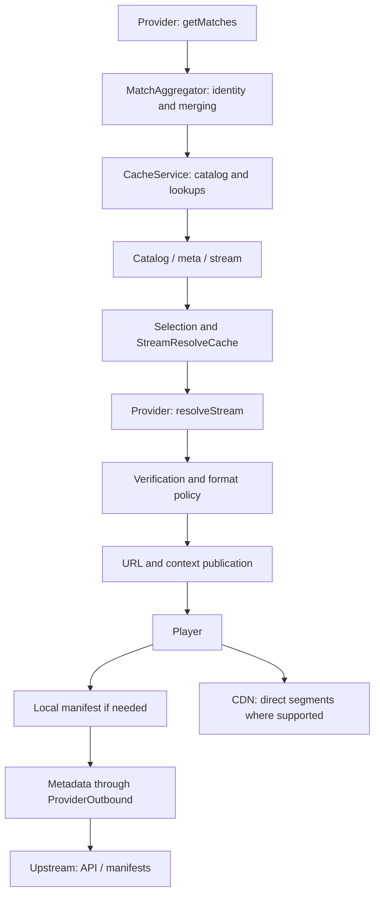

# Guide to adding and maintaining providers

[Versión en español](PROVIDER_GUIDE.md) · [PR and AI task template](PROVIDER_PR_TEMPLATE.md)

This guide explains how to choose an implementation, connect it to the addon,
show that it works and maintain it when the provider changes. Its proposed
contribution rules do not replace the actual GitHub settings or guarantee that
an external service will remain available. Every claim must correspond to the
commit, environment, format and player that were tested.

## Contents

1. [Version and prerequisites](#1-version-and-prerequisites)
2. [Choosing the implementation](#2-choosing-the-implementation)
3. [Request flow and ownership](#3-request-flow-and-ownership)
4. [Entity contracts](#4-entity-contracts)
5. [Files and integration points](#5-files-and-integration-points)
6. [Requests and destination guards](#6-requests-and-destination-guards)
7. [APIs, HTML and partial failures](#7-apis-html-and-partial-failures)
8. [Dates and identity](#8-dates-and-identity)
9. [HLS: masters, variants and resources](#9-hls-masters-variants-and-resources)
10. [Headers and player compatibility](#10-headers-and-player-compatibility)
11. [Tokens, signed routes and egress](#11-tokens-signed-routes-and-egress)
12. [Caching, concurrency and prewarming](#12-caching-concurrency-and-prewarming)
13. [Health and diagnostics](#13-health-and-diagnostics)
14. [Supported formats and video costs](#14-supported-formats-and-video-costs)
15. [YAML and the generator](#15-yaml-and-the-generator)
16. [Builds and extractors](#16-builds-and-extractors)
17. [Tests and commands](#17-tests-and-commands)
18. [Isolated validation and evidence](#18-isolated-validation-and-evidence)
19. [Merging, VPS deployment and configuration](#19-merging-vps-deployment-and-configuration)
20. [Troubleshooting by symptom](#20-troubleshooting-by-symptom)
21. [Lessons and final review](#21-lessons-and-final-review)
22. [Code references](#22-code-references)

## 1. Version and prerequisites

**Reference date for this edition: November 4, 2026.** Distinguish two profiles:

| Profile | What it represents |
| --- | --- |
| Documentation base | `stable` at `92589e4c0bef327d7cc483c3fbe2d40908ba8e17` |
| Guarded integration | #59 `6ada76562e104598db601c478dabf88437e0556b` and #61 `0c559a6bb5037eb1a02b0919dd399ea328126694`; #61 includes that exact #59 |

When this guide was prepared, both PRs were still open and unmerged.
`ProviderOutbound`, the identity/recovery corrections and the cited runners
belong to the integrated profile: **they are not all present in that `stable`
base**. The transport and test examples below require that profile. Before
implementing them, integrate the dependency or declare the new PR dependent on
it; do not replace missing modules with unguarded requests.

At the start, record the exact base, dependencies and candidate. Recheck them
before publishing or resolving a conflict. The SHAs above identify this edition;
they are not permanent names for future versions.

```sh
git status --short
git rev-parse HEAD HEAD^{tree}
git log -1 --format='%H %P'
```

These commands only inspect the checkout. A branch name, a directory without
`.git` or a build hash alone does not prove where the source came from.

Vocabulary used in this guide:

| Term | Meaning here |
| --- | --- |
| Metadata / media | Catalogs and manifests / audio or video bytes; they have different costs and tests |
| Mint | Requesting a credential or playback URL from the upstream through its supported mechanism |
| Egress | Effective network exit: direct route or proxy, IP and profile affecting the request |
| Pin | Expected resolver identity/certificate loaded by the worker |
| Preflight | Verification before stream publication; not evidence of device playback |
| Single-flight | Sharing one in-flight operation per key instead of duplicating it for every request |
| Claim / revision | Temporary ownership of work / version of a cache publication |

## 2. Choosing the implementation

First document what the upstream supplies and what the server must do.

| The provider supplies… | Suitable implementation | Distinguishing test |
| --- | --- | --- |
| JSON events and direct HLS | Provider class, per-row parser and separate resolution | Valid/malformed/valid events; actual output through publication |
| HTML bridge pages or iframes | Extractor bounded by format/host | Relative links resolved against each page's final URL |
| Simple HTML that only opens a web player | YAML, if its limitations are acceptable | Correct `externalUrl`; do not describe it as direct media |
| HLS master and multiple tracks | Resolver plus shared HLS rewriting | Video, audio, I-frame, extensionless children and redirects |
| Expiring signed URL | Official resolution/mint when needed; suitable cache | Before/after expiration and bounded recovery |
| Token bound to IP or TLS profile | Mint and manifest with consistent egress/profile | Same effective configuration; actual playback from the device |
| 24/7 channels | Channel identity, number, country and `networks` classification as required | Channel 1 separate from 2; channel separate from a scheduled fixture |
| Replays/VOD | Recording identity and date; registration as a replay source | Separate meetings between the same teams and different games do not merge |
| Only an alternative web page | Honestly labeled `externalUrl` and retry policy | The alternative does not count as approved direct playback |
| DASH/ClearKey or unsupported content | Filter according to the current offering policy | Absent from offered streams |
| PNG segments, notice HTML or unknown bytes | Classify with evidence; exclude unsupported cases | Bounded sample and/or actual player, without inferring format from extension |

One source may require several rows. Add a streaming endpoint only when existing
routes and services cannot satisfy its contract. Document that difference before
adding shared code or new transports.

## 3. Request flow and ownership



This diagram describes the metadata design with direct segments. It does not
certify that every legacy route follows it or authorize a new video relay.

Complete a table like this for each provider before coding:

| Request | Owner | URL/base and headers | Egress | Limit and expected result |
| --- | --- | --- | --- | --- |
| Catalog | Server | Events API, appropriate `Accept` | Approved policy | Complete JSON; empty is distinct from an error |
| Channels/mint | Server | Official API; private credentials if applicable | As required by the token | Bounded response; no private logs |
| Master/child | Explicitly server or player | Final URL and context for that stage | Consistent with mint | Valid HLS, neither truncated nor a notice |
| Segment/key/map | Usually player | URI and context for that resource | Device network | Compatible bytes and actual access |
| Web alternative | Browser/device | Labeled external page | Device network | Web handoff; not a native-media PASS |

Do not transfer a private server credential to the client to complete a row.
If the contract cannot be satisfied without doing that, declare the limitation.

## 4. Entity contracts

A dedicated class normally extends `src/providers/BaseProvider.js`:

```js
class ExampleProvider extends BaseProvider {
  constructor(opts = {}) {
    super(opts); // BaseProvider destructures the options object.
    this.name = 'Example';
    this.sourceName = 'example';
  }
  isEnabled() { return process.env.EXAMPLE_ENABLED === 'true'; }
  // getMatches() -> Promise<MatchEntity[]>
  // resolveStream(sourceId, matchCategory, matchTitle, src) -> Promise<StreamEntity[]>
}
```

This is an outline, not a complete provider. The base class does not register
the toggle, implement the parser or connect the dispatcher automatically.

| Data | Contract and considerations |
| --- | --- |
| `MatchEntity.id` | Stable canonical identity; provider prefix where appropriate. Do not use feed position, signed URL, token or `Date.now()` as identity |
| `aliasIds` | Compatibility with known IDs; an ambiguous collision does not select the first card |
| `title`, `category` | Validated title and canonical category; preserve country, age, gender, reserve-team and session identity |
| `date` / `timestamp` | Actual normalized date; the constructor produces a millisecond epoch string. `timestamp` takes precedence when supplied |
| `status` | Map known states, such as `live`, `upcoming`/`pre`, `finished`/`ended`, `postponed`, `cancelled`. Do not invent availability |
| `sources` | Array of alternatives with `source`, `id` and the context needed to resolve the same source later |
| `isReplay`, `isChannel` | Help classify an entry; do not update every addon registry by themselves |
| `StreamEntity.url` | Supported media or manifest route; not a disguised HTML page |
| `StreamEntity.externalUrl` | Explicit web alternative; not evidence of native player compatibility |
| `_source`, `sourceName` | Identifiers consistent with selection, dispatch, labeling and health |
| `behaviorHints` | Player context subject to verification/publication; not playback evidence |

Categories recognized by the current helper: `football`, `cricket`, `basketball`,
`motorsport`, `hockey`, `baseball`, `mma`, `golf`, `tennis`, `rugby`,
`american_football`, `darts`, `college`, `networks`, `other`. Review the actual
mapping: labels such as AFL can be ambiguous between sports. Do not create a
category ID that no catalog queries.

Example mapping of an **already validated** row from a fictional API:

```js
new MatchEntity({
  id: `example_${row.id}`,
  title: row.title,
  category: this.normalizeCategory(row.sport),
  date: String(kickoffMs),
  sources: [{ source: 'example', id: String(row.id) }]
});
```

Entity constructors do not replace schema, calendar or identity validation.
`StreamEntity` preserves specific fields; check that a new field survives the
constructor, caching and publication.

## 5. Files and integration points

| Location | What to review/change when applicable |
| --- | --- |
| `src/providers/ExampleProvider.js` | Separate discovery and resolution; toggle and validation |
| `src/container.js` | Import and Awilix registration; consistent registration name |
| `src/services/MatchAggregator.js` | Constructor injection and inclusion in `this.providers`; actual exclusion when disabled |
| `src/streams.js` | `dispatchToProvider`, live/replay lists and `KNOWN_FALLBACKS`, priority and labels |
| `src/catalog.js` | `REPLAY_SOURCES` for new replays; classification in every relevant catalog |
| `src/services/StreamResolveCache.js` | TTL and context policy if existing behavior does not cover the new source |
| `public/configure.html` | Static `liveSourcesGrid` / `replaySourcesGrid` checkboxes; old and new configuration |
| `.env.example` | Variable names, defaults and an example without real credentials |
| `src/index.js` | Mount a new route if needed; ordering relative to the resolver proxy; `STREAM_PREFIXES` and the absolute-URL rewrite regex |
| `src/services/HlsRewriteService.js` | Reuse the shared contract; regression-test other providers if it changes |
| `scripts/copy-guarded-worker-deps.js` | Helpers required by extractors or processes copied outside the bundle |
| `tests/` and offline runners | Parser, integration and boundary fixtures; deliberate suite selection |
| Documentation | Supported formats, limitations, variables, tests and evidence |

`/api/options` publishes languages and replay filters; it is not a universal
provider registry. Adding a checkbox or an import is insufficient.

Test selection with absent configuration, explicit inclusion, exclusion and
`none`, as well as legacy configuration formats. In the audited implementation,
the literal string `sources=all` does not act as a wildcard; do not assume it does.
YAML has a legacy selection exception even with `none` lists: do not describe
that as complete isolation without correcting and testing it.

The toggle must cover discovery, direct dispatch and new public routes. A route
mounted unconditionally can continue making requests even if the provider is
absent from the catalog. With the provider disabled, verify zero I/O and a
controlled response across all applicable entry points.

## 6. Requests and destination guards

In the integrated profile, every new metadata request must enter through
`src/services/ProviderOutbound.js`. URL validation and the connection guard
serve different purposes; use both where the contract requires them.

```js
const outbound = require('../services/ProviderOutbound'); // from providers/

async function fetchCompleteJson(url, signal) {
  const response = await outbound.safeFetch(url, {
    headers: { Accept: 'application/json' },
    signal,
    timeoutMs: 8000,
    maxBodyBytes: 256 * 1024,
    attempts: 1,
    diagnosticOwner: 'catalog'
  });
  if (!response || !response.ok) {
    const error = new Error('Provider catalog unavailable');
    error.code = 'ERR_EXAMPLE_CATALOG_HTTP';
    error.upstreamStatus = response?.status;
    throw error;
  }
  if (response.bodyTruncated) {
    throw Object.assign(new Error('Provider metadata exceeds limit'), {
      code: 'ERR_EXAMPLE_METADATA_LIMIT'
    });
  }
  return response.json(); // Then validate the provider-specific schema.
}
```

The 8s/256KiB limits are choices for this example; measure each API. The audited
shared profile defaults to 15s/1MiB, accepts 1–3 attempts, a total budget up to
30s and a buffered body up to 8MiB. Do not treat these maxima as targets for
every request or multiply retries across layers without a budget.

- `safeFetch`: `ok`, `status`, `headers`, `url`, `bodyTruncated` and body methods.
- `request`: `statusCode`, plain headers and methods on `body`; do not confuse it with `Response`.
- `fetch`/`fetchUndici`: buffered `Response` with final URL and truncation information.
- `streamingFetch`: a different contract; not a general substitute for bounded metadata.

`BaseProvider.proxyFetch()` enters the integrated adapter but forwards only some
options. It currently does not pass `proxyUrl`, `profile` or `redirect`, and may
use a configured CF proxy. For precise egress control, use the adapter directly.
A remote wrapper introduces its own trust boundary: validating the proxy URL
does not establish that the remote service validates its destination.

Avoid new requests through `../impitClient`, `undici`, global `fetch`, native
clients or curl created inside the provider. Transport exceptions require the
shared protection, cancellation, limits and tests; DamiTV's guarded curl is not
permission to launch curl against arbitrary URLs.

Do not resolve incompatibilities by disabling TLS checks, allowing loopback or
private networks, following redirects outside the guard, or adding direct
fallback when a proxy is required. Checks cover DNS and every hop at connection
time; checking only `http(s)` or same origin does not replace them.

When selecting hosts, parse `URL.hostname` and compare an exact host or a
subdomain with a dot boundary. `url.includes('provider.com')` accepts that text
in a path, query or impostor domain. Reject embedded credentials and validate
protocols and ports according to policy. A link handed to the player is not a
server-side request: document validation at each boundary.

## 7. APIs, HTML and partial failures

**API/feed:** validate the root, arrays, rows and types before iterating. Process
units independently: valid → `null`/malformed → valid must retain both valid
entries. With multiple sports/endpoints, preserve successful responses and
report degradation. If all fail, report total failure rather than presenting
an apparently healthy empty catalog.

**HTML/iframe:** resolve references against the effective URL of the containing
page, after redirects. Apply that rule at every bridge page. Bound depth,
candidate count and requests. A failed option must not discard independent
alternatives. Do not execute arbitrary code from HTML.

**M3U/text:** test LF/CRLF, reordered headers, missing fields and values containing
`=`. Split at the first delimiter when the value may contain it. Clear header
context between entries so that the next stream does not inherit credentials
or User-Agent from the previous one.

Reject truncated metadata before parsing, rewriting or caching a success, even
when its prefix looks like valid JSON/HLS. If an operation deliberately samples
a prefix, identify it as a probe and do not reuse it as a complete catalog.

## 8. Dates and identity

Identify timestamp units, timezone and whether a value represents kickoff, a
replay's calendar day, LIVE status or a news publication time. Validate ranges
and round-trip components: `Date.UTC` normalizes month 13 into another year, for
example; producing a number does not validate the original calendar. Test UTC
day boundaries, daylight saving changes and invalid months/days with a controlled
clock.

Do not replace unknown dates with the current time to improve sorting. Leaf's
existing LIVE-without-time behavior is a source-specific decision, not a recipe
for every feed. A 24/7 channel may have no kickoff; an undated fixture does not
therefore become a channel. A replay with a local calendar day does not
automatically have a precise UTC time.

Identity must preserve:

- Fixture: participants, category, date and each participant's qualifiers.
- Teams: gender, age, reserve-team labels and reversed order without moving labels between teams.
- Motorsport: series and session; qualifying and the race are different events.
- Replay: calendar day/time, game number and constraints from the original events.
- Channel: country, number and signal; a generic channel does not establish coverage rights for a fixture.

Use shared services (`EventSquadIdentity`, `ChannelIdentityService`,
`BroadcasterMatchService` and aggregator logic where present). Do not add parallel
fuzzy matching to bypass their constraints. Test accents/Unicode, legitimate
aliases and two nearby meetings between the same teams.

For recovery and caching, use `StreamResolveCache.resolveKey(src, match.id)` with
the resolved canonical ID, not the request's alias. An ambiguous alias must
produce an explicit miss/ambiguity rather than select the first result.
Carry-forward requires freshness and semantic compatibility even when an old ID
matches. Do not add a provider to a rescue list without defining retention,
identity, bounds and its health-reporting effect.

## 9. HLS: masters, variants and resources

Reuse `HlsRewriteService` and preserve each URI's meaning. An extension does not
always reveal whether a resource is a playlist, key, map or segment.

| Reference | Behavior to verify |
| --- | --- |
| Line after `EXT-X-STREAM-INF` | Video variant, even without a `.m3u8` suffix |
| `EXT-X-MEDIA:URI` | Audio/subtitle playlist as defined by the format; do not confuse with video |
| `EXT-X-I-FRAME-STREAM-INF`, `EXT-X-IMAGE-STREAM-INF` | Auxiliary playlists with their own identities |
| `EXT-X-RENDITION-REPORT` | Reference to another playlist; support it or declare the limitation |
| `EXT-X-KEY`, `EXT-X-SESSION-KEY` | Key resource: retain semantics and authentication; do not turn it into a variant based on its suffix |
| `EXT-X-MAP` | Init segment; preserve parameters/ranges |
| `EXT-X-PART`, `EXT-X-PRELOAD-HINT` | LL-HLS resources; explicitly test them if support is advertised |
| Media segments | Direct URLs and usable player context, according to the supported policy |

A callback such as `toPlaylistUrl` must share the same URI map with the route
resolving indices. Do not count one set of tags and resolve against another.
Test audio before video, I-frame before the first variant, repeated URIs, missing
indices and master changes on refresh. If variants reorder, an old index must
not silently resolve different content: use a consistent snapshot/identity or
fail in a controlled way.

Resolve children against the manifest's final URL, not its pre-redirect URL.
Preserve signed queries without double decoding/encoding. Parameter inheritance
for relative references must follow the contract; never copy a token to another
origin for convenience. Test URLs containing `%2B`, `%2F`, `%3D` and `=`.

`#EXTM3U`, HTTP 200 or a segment list does not prove useful media. Detect known
notices, HTML, JSON errors and truncation before caching. The existing helper
does not automatically guarantee every case in this table: add missing coverage
before advertising support.

## 10. Headers and player compatibility

Specify the headers needed for each row in the request table. `Referer` may have
a path; `Origin` must be a valid origin without that path. Normalize header-name
casing without changing values, and bound lengths/characters.

On cross-origin redirects, the integrated policy keeps only `Accept`,
`Accept-Language`, `Accept-Encoding`, `User-Agent`, `Range`, `Content-Type` and
`Content-Encoding`. It drops `Referer`, `Origin`, `Cookie`, `Authorization` and
custom headers. Do not automatically restore them on the next hop. An allowed
value may still contain a secret; the list does not sanitize it.

`behaviorHints.proxyHeaders` does not guarantee that every device sends those
headers for master, child, segments and keys. Test the declared players,
including MPV and Stremio/Exo/Nuvio when they are part of the target. If a browser
cannot satisfy the contract, declare the limitation instead of silently enabling
a relay.

**Watch verification of the addon itself:** `notWebReady:false` currently can
skip preflight. Changing it to `true` may cause a request to a custom local route,
which the guard rejects when the addon uses LAN/loopback. Publication also
modifies these hints and headers. Always test the actual `resolveStream()` output
through verification and publication with both public and private addon URLs.
Do not manually alter a fixture to avoid the failing branch or allow localhost
in the guard to resolve it.

A particular UA can change the response: separate cache entries by normalized
context where necessary, and propagate only authorized context to children.
Do not forward upstream cookies/Authorization to the addon's public URL.

## 11. Tokens, signed routes and egress

For short-lived or IP-bound tokens, prefer an opaque local identifier and official
minting when the manifest is requested. Define exactly what is signed and what
context determines content; do not invent upstream credentials or bypass an
authorization notice using another identity.

A new signed route must:

1. Use a configured private key shared across workers; fail closed without it. Do not include a public development constant as fallback.
2. Bound token, ID, query and payload lengths/types before expensive work; account for arrays/objects Express may produce.
3. Validate encoding and length **in bytes** before `timingSafeEqual`; Unicode inputs must not throw `RangeError`.
4. Check schema, version if used, issue timestamp and maximum lifetime; reject future, expired or missing fields.
5. Bind selectors that authorize content, or validate them against the authorized set; do not accept arbitrary destinations through query parameters.
6. Catch errors from the start of the handler and return fixed 4xx/5xx responses without private URLs/tokens/errors.
7. Limit requests and state even for valid signatures; establish client identity through trusted proxies rather than blindly trusting `X-Forwarded-For`.

Choose egress once and preserve it throughout the operation. For hosts that
`GuardedEgressPolicy` classifies as Leaf, the audited priority is
`LEAF_PROXY_URL → WARP_PROXY_URL → DAMITV_PROXY_URL`; Dami uses WARP→DAMITV.
The Leaf classifier excludes `w1.papacito.cfd` and its subdomains: do not assume
that every Leaf-branded host automatically receives that proxy. Verify effective
egress at each stage and any exception against the token's contract.
`proxyUrl:null` explicitly selects a direct route; it is not an absent variable.
Do not copy these priorities to another provider without a reason. A required
proxy does not permit direct fallback on failure.

Separate expiry recovery from local failures:

| Signal | Appropriate response |
| --- | --- |
| Upstream expiry confirmed by its contract | Conditional invalidation and at most the defined retry/mint within budget |
| `ERR_OUTBOUND_BLOCKED`, capacity or local native failure | Local error; no remint, bypass or new identity |
| 429 | Bounded backoff/cooldown; no cache-buster storm |
| Authorization, installation or unsupported-media notice | Reject and explain the limitation; do not claim success |
| Timeout/5xx | Documented transient policy; stale data only if still valid and not hiding a denial |

A 403 alone does not establish expiration. The master URL may remain valid while
a signed segment fails: verify that stage too.

Using the same egress for mint and manifest does not guarantee valid direct
segments. If segment authorization is also bound to the server's IP, a player
with another IP may fail even when the master works. Verify that contract; if
the upstream offers no mechanism compatible with direct delivery, declare the
case unsupported instead of automatically introducing a video relay.

## 12. Caching, concurrency and prewarming

| State | What must be defined |
| --- | --- |
| Catalog | Freshness, date transitions, partial results and storage path |
| Positive resolution | Canonical key, context and actual expiration; clone before personalization |
| Negative result/web fallback | Justified short TTL and an opportunity to retry direct media |
| Mint/playback | Bounds per credential and egress, single-flight and cooldown |
| Manifest | TTL appropriate to the live edge, variant snapshot and complete body |
| In-flight | Cleanup on success/error/cancellation; do not retain rejected promises |
| IP/rate limits | Maximum size, window and eviction; trusted identity source |

A TTL does not automatically remove old keys from a `Map`. Bound entries, evict
expired ones and test growth, errors and aborts. Do not cache one user's or UA's
personalized result for another. An opaque local route does not automatically
let the cache infer when its hidden credential expires.

Current resolution values: a 60s positive base, 30s for negative results,
a maximum of 200 entries and adaptation up to 10min; Daddy has a 150s cap and
Leaf a 4h exception. These are current profile/configuration details, **not
universal defaults for new providers**. Test changes to `StreamResolveCache`;
do not copy an exception.

The shared cache uses revisions and conditional invalidation. Do not replace
that with unconditional deletion that can erase a newer publication. Do not
mutate borrowed snapshots or release another operation's claim.

Bound fan-out and the total budget, including DNS, queueing, redirects, retries
and reading. The isolated native supervisor defaults to 4 slots per pool and
accepts `GUARDED_NATIVE_MAX_SLOTS` from 1 to 8; the `NativeGuardedFetch` backend
has its own maximum of 4 per pool/context. This does not establish one global
limit of 4 for the whole VPS: multiple workers/pools multiply resources. Check
the backend, processes and total deployment limit; raising caps to fit a provider
is not an integration fix. An outer sync timeout does not itself cancel internal
work: pass signals where the contract supports them.

Prewarming is optional and separate from interactive resolution. Evaluate cost,
token lifetime and blocking before enabling it. Review
`DEFAULT_PREWARM_SKIP_PROVIDERS`; an explicit `PREWARM_SKIP_PROVIDERS` replaces
the default rather than extending it. A provider excluded from prewarming must
still resolve on click when enabled.

## 13. Health and diagnostics

| Current state | Meaning to preserve |
| --- | --- |
| `healthy` | Successful retrieval with fixtures |
| `empty` | Valid response without fixtures; distinct from transport failure |
| `degraded` | Partial result or failed schedule exposed through the contract |
| `error` | Reported total failure or exception |
| `cached` | Explicit reuse of earlier data |

`lastScheduleOk === false` communicates degradation to `ProviderHealthService`
in the current implementation. Do not hide every error behind `return []` or
let a late result from a timed-out attempt overwrite a newer attempt.

Record error class, HTTP status, phase, duration and safe correlation. Do not log
secrets, install blobs, cookies, Authorization, signed URLs, JWT identity claims,
proxy credentials or the private catalog. Library errors may include them in
`message`. Current health redaction does not remove every path or userinfo value;
do not treat it as a universal sanitizer.

If a URL must be identified, retain an allowed host and classification or an
appropriate non-reversible fingerprint; do not share its private query/path.
A fingerprint does not prove that the content played either.

## 14. Supported formats and video costs

Distinguish metadata from media. Rewriting a small manifest and returning CDN
URLs lets the player download segments; decoding or relaying them on the VPS
changes costs, performance and the operational contract.

The current `stable925` policy stops **offering** relayed DASH/ClearKey. Do not
add producers that publish it again or describe it as an acceptance requirement.
The continued presence of legacy routes does not establish offered support or
complete destination guarding across every video route.

**DaddyLive policy agreed with Raj:** support the `/player` path when it delivers
actual MPEG-TS segments. Exclude dembed/premium alternatives that require
server-side PNG decoding, and prevent them from returning through another
fallback. This is a support decision, not proof that every URL with those names
has the same format or an explanation of every historical 404.

`.ts`, `.png`, `Content-Type` and HTTP 200 alone do not establish format.
Distinguish actual TS, prefixed TS, actual/compressed PNG and notice/HTML using
an authorized bounded sample and playback. If unknown, label it unknown.
Do not apply offset 42, BYTERANGE or a decoder to every segment because it looks
similar to another provider. Keep a working control for the supported path and
record exclusions instead of promising that every link works.

## 15. YAML and the generator

```sh
npm run generate:provider -- Example
```

This command creates **only** `src/providers/yaml/example.yml`. It does not
generate a complete JS class, dispatcher, route, tests or player integration.
Review the script before running it, and do not overwrite an existing file.

`GenericYamlProvider` lives in `src/services/YamlProviderBuilder.js`. The audited
code uses index-based IDs, `Date.now()` as date and `externalUrl`; it reads
`selectors.time` text without converting it to kickoff and resolves against
`baseUrl`, not necessarily the final redirected URL. These limitations require
improvements or a dedicated class for fixtures with identity, schedules, minting
or direct HLS.

Use YAML only when a simple web handoff is the intended result and these
contracts have been reviewed. Do not call the scaffold a completed integration
or disable validation to fit a complex provider into YAML.

## 16. Builds and extractors

`npm run build` uses ncc and copies JS/WASM extractors and assets into
`dist.next`. Some provider scripts have a flat distribution layout that differs
from `src/providers/`. A `require('../services/...')` that works in source may
fail there. Test import resolution in both layouts without starting WASM.

When a helper is needed outside the bundle, add it to the appropriate copy
manifest. Check copied files, relative imports and assets in the actual build.
A build that packages a binary does not prove that binary works on another
architecture, libc, Node version or device.

Do not introduce a new browser, worker, subprocess or transport without defining
ownership, limits and cancellation. Sending SIGTERM to a child does not establish
that it exited: wait for close before reusing resources and check descendants.

## 17. Tests and commands

Tests must pin observable behavior and fail if protection is lost. Separate
synthetic fixtures, sanitized captures and real cases. Do not modify fixtures
to avoid the failing branch or present a simulated HTTP 200 as evidence of a
real provider.

| Level | Minimum applicable cases |
| --- | --- |
| Parser | Valid empty; valid/malformed/valid; null and wrong types; LF/CRLF and delimiters |
| Identity/dates | Feed reordering; reused IDs; ambiguous aliases; country/signal; age/gender/reserves; invalid calendars and UTC |
| Transport | Private and mixed DNS; redirect to blocked destination; URL credentials; timeout/capacity; truncated body; proxy without direct fallback |
| Headers/HLS | Casing/UA; cross-origin secrets; master/audio/I-frame/extensionless child; final URL and signed query |
| Signed state | Missing key; invalid/Unicode signature; maximum sizes; future/expired; query array; disabled toggle |
| Cache | Positive/negative expiry; single-flight; error/abort and retry; revision/invalidation race; bounded growth |
| Integration | Actual provider with mocked I/O → aggregation/cache → catalog/meta → dispatcher → verification → publication |
| Compatibility | Existing provider before/after shared-helper changes; old/new configuration and runtime/build layouts |
| Runtime | Real transport and player only in a suitable isolated instance |

Test a local route with both public and private `BASE_URL`. Check fields and
headers after publication, not only at the parser output. If adding a verifier
exception, show that it covers only the intended owned routes and does not
permit arbitrary server-side requests.

With locked dependencies installed and **the integrated profile present**:

```sh
# Example: create this suite first; the name is not an existing test.
node --require ./tests/fixtures/pr59-offline-boundary.cjs \
  ./node_modules/jest/bin/jest.js --runInBand \
  --runTestsByPath tests/exampleProvider.test.js

# Inherited selections when affected by the change:
node scripts/test-pr59-offline.cjs
node scripts/test-pr61-offline.cjs

# Build in the prepared development environment; may use tools through npx.
npm run build
```

Node 22.23.2, Node 24.19.0 and Jest 29.7.0 were used in the reference reviews;
respect the project's Node>=22 contract and record your own versions.
`npm ci --include=dev` installs the lockfile in a development checkout when
needed; do not substitute production dependency updates to test a source.
Do not interpret the runner's network/worker boundary as a provider failure.

Offline suites block real connections, listeners and workers. Mock
Router/transports before importing modules that could start them. Separate
server, binary and WASM suites and run them only in the appropriate environment.
Once relevant checks pass, broaden testing when the diff, a failure or a concrete
uncertainty warrants it. A passing selection is not a full repository pass.

## 18. Isolated validation and evidence

Use one instance at a time when RAM is under pressure. Keep its build, ports,
socket, test credentials and `MATCHES_CACHE_PATH` separate from production.
Do not read/write the active production cache while claiming isolation; a private
copy must be identified as a copy, with its hash and activation time.

Verification order:

1. Freeze SHA/tree and staging provenance; capture installation/build results and your own hashes.
2. Confirm required configuration and addon/resolver health; record omitted checks as `NOT RUN`.
3. Follow catalog → meta → stream using the catalog actually active in the instance.
4. Test master → child → segment/key and necessary headers; distinguish probing from playback.
5. Play on the declared devices and record player, version, duration and actual result.
6. Test expiration/recovery or egress only when applicable and configured.
7. Stop owned processes: PID, start ticks, descendant identities before exit and listeners. A survivor is a failure; text-based `pgrep` does not establish ownership.

A segment sample differs from HEAD and from playback. A successful master, web
fallback or notice does not turn a media failure into PASS. Do not rerun the
entire TLS/cache/rotation matrix when the change does not affect it; preserve
its scoped evidence and add the necessary targeted check on the new candidate.

Example **template without captured results**:

```json
{
  "candidate_sha": null,
  "tree_sha": null,
  "source_provenance": null,
  "build": { "exit_code": null, "index_sha256": null },
  "active_catalog": { "sha256": null, "events": null, "activated_at": null },
  "case": "provider -> published stream -> player",
  "status": "NOT RUN",
  "player": null,
  "started_at": null,
  "duration_seconds": null,
  "observations": [],
  "owned_shutdown": { "status": "NOT RUN" }
}
```

Use `PASS`, `FAIL` and `NOT RUN` with reasons and scope. Keep original sanitized
stdout/stderr, commands and exit codes. If an output was not saved, say so;
do not reconstruct it as an original log. A build hash identifies bytes but does
not itself prove that staging came from the declared commit.

## 19. Merging, VPS deployment and configuration

Merging on GitHub does not require editing the VPS. Deployment does require
checking dependencies and the environment. Separate code acceptance, runtime
acceptance and provider enablement. A new opt-in source may remain disabled
while validation is pending; its routes must respect that disabled state too.

**Shared #59/#61 migration:** the agreed target is an external resolver over
pinned Unix/TLS. If the VPS still has only the old TCP transport, merging does
not migrate it. Without a selected mode, dependent APIs may return 503; an
explicit but invalid TLS configuration may prevent startup.

```dotenv
# Template: replace paths, hostname and port with the actual instance values.
RESOLVER_TRANSPORT=systemd-unix-tls
RESOLVER_SOCKET_PATH=/run/<instance>/resolver.sock
RESOLVER_CERT_DIR=/path/to/public-identity
RESOLVER_TLS_SERVERNAME=resolver.internal
RESOLVER_PORT=7003
RESOLVER_TRUST_LEGACY_TCP=false
```

The directory must contain public `resolver.crt`, delivered through a trusted
path; the private key belongs to the resolver. Prepare the service/socket,
permissions and a valid identity before starting the addon: `.env` alone does
not create them. The configured port constrains the cache adapter's URLs; it
does not enable a TCP fallback. The site's HTTPS certificate is a separate
identity. Do not reuse a short-lived test identity in production or copy
isolated-test units without adapting them to the deployment.

If valid configuration already exists, verify it rather than changing it
routinely. Workers must share the pin and chosen private local-state signing
key when that feature is enabled. Leaf accepts `LEAF_STATE_SECRET` or
`APP_SECRET`; `SESSION_SECRET` alone does not satisfy its contract. Merging does
not require rotating existing secrets or enabling Leaf or another unconfigured
provider. DamiTV remains on by default unless `DAMITV_ENABLED=false`; do not
confuse it with new opt-in providers. Retired relayed-DASH offering does not
require a new playback check or an additional key solely for that removed case.

Before rollout, verify health 200, the correct pin/CA/hostname, a controlled
request and playback in isolation. Deploy compatible resolver and worker
versions; shared invalidation does not retain all its guarantees with mixed
versions. An identity change requires restarting workers that loaded the old
pin. Do not enable legacy TCP as a shortcut to make health pass.

Record the previous build/configuration and rollback procedure. Reverting a
merge does not itself restore VPS credentials, catalog or processes. Document
those effects and rollback order; do not perform production changes as part
of a provider test.

## 20. Troubleshooting by symptom

| Symptom | Check first | What it does not establish by itself |
| --- | --- | --- |
| No events appear | Toggle, registration, selection, category, date and health | That the API is down |
| Card exists but no streams | Canonical/source ID, dispatcher, verifier and format policy | That the catalog parser is wrong |
| Public works, LAN fails | Preflight to an owned route and publication base | That private networks must be allowed in the guard |
| Health 503 | Resolver selection/configuration and pin | That the provider's upstream is down |
| Addon returns 404 | Origin of 404, route, recovery and event identity | An upstream 404 or a specific PNG issue |
| HTTP 200 but player fails | Master/child, headers, content and segment expiration | Successful playback |
| No audio or variant 404 | Master tags/indices and snapshot, final base | Necessarily a codec error |
| Fails after a few minutes | Token, expired segments, egress and cache | That increasing TTL fixes it |
| PNG/empty segment | Actual bytes, notice, compression or documented prefix | That `.ts` is TS or offset 42 is valid |
| 429 or native capacity | Fan-out, queue, cooldown and budget | Permission for more retries or bypass |
| Fails only after build | Flat-layout imports, helpers and assets | That source execution validates the bundle |
| RAM remains high after stop | Owned process identity/start ticks/descendants and listener | A leak established by counting foreign processes |

## 21. Lessons and final review

| Reference case | Reusable lesson |
| --- | --- |
| Alias/prewarm/recovery | Share a canonical-ID cache-key constructor |
| Guard403 treated as expiry | Classify the error's origin before reminting |
| Leaf-specific proxy | Audit effective priority in the guarded adapter too |
| Fallback key and Unicode signatures | Fail closed and check encoding/bytes before comparison |
| Scorezone: I-frame before video | Publication and resolution must share exactly the same variant map |
| Scorezone: changed hint, old fixture | Test the actual class output through publication |
| DaddyLive124/19 | An addon error does not establish its upstream cause; retain control and scope |
| DaddyLive `/player` | Define supported format, verify bytes/player and exclude paths needing an unapproved decoder |
| YAML generator | A scaffold and web handoff do not equal a complete provider |

The Scorezone cases refer to the review of `3109411`, with bounded synthetic
reproductions; they are not a production playback report. This guide turns those
cases into required tests, not a claim that another version still fails.

Recommended contribution workflow:

1. One dedicated PR per provider; declare dependencies and formats before implementation.
2. Behavior, integration and boundary fixtures; relevant regressions for shared changes.
3. First independent review of transport/state/resources and second of identity/HLS/compatibility; close findings on the final tree.
4. Record actual checks and pending work; agree on merge and rollout separately.
5. Communicate new SHA/tree after changes; do not attribute earlier tests to a new candidate without defining what remains applicable.

These are proposed guide rules, not a claim that GitHub already requires two
approvals or that each provider needs every device in existence. Apply the
relevant case matrix and explain non-applicable cases. The
[PR template](PROVIDER_PR_TEMPLATE.md) makes that scope reviewable.

## 22. Code references

These links pin the audited profile; also consult the actual candidate's code:

- [BaseProvider and proxyFetch](https://github.com/rajhodedara/live-sport-plugin/blob/0c559a6bb5037eb1a02b0919dd399ea328126694/src/providers/BaseProvider.js)
- [ProviderOutbound](https://github.com/rajhodedara/live-sport-plugin/blob/0c559a6bb5037eb1a02b0919dd399ea328126694/src/services/ProviderOutbound.js)
- [Match](https://github.com/rajhodedara/live-sport-plugin/blob/0c559a6bb5037eb1a02b0919dd399ea328126694/src/domain/MatchEntity.js) and [Stream](https://github.com/rajhodedara/live-sport-plugin/blob/0c559a6bb5037eb1a02b0919dd399ea328126694/src/domain/StreamEntity.js) entities
- [Aggregation and identity](https://github.com/rajhodedara/live-sport-plugin/blob/0c559a6bb5037eb1a02b0919dd399ea328126694/src/services/MatchAggregator.js)
- [Selection, verification and publication](https://github.com/rajhodedara/live-sport-plugin/blob/0c559a6bb5037eb1a02b0919dd399ea328126694/src/streams.js)
- [HlsRewriteService](https://github.com/rajhodedara/live-sport-plugin/blob/0c559a6bb5037eb1a02b0919dd399ea328126694/src/services/HlsRewriteService.js)
- [Egress selection](https://github.com/rajhodedara/live-sport-plugin/blob/0c559a6bb5037eb1a02b0919dd399ea328126694/src/services/GuardedEgressPolicy.js)
- [Resolution cache](https://github.com/rajhodedara/live-sport-plugin/blob/0c559a6bb5037eb1a02b0919dd399ea328126694/src/services/StreamResolveCache.js)
- [YAML and its limitations](https://github.com/rajhodedara/live-sport-plugin/blob/0c559a6bb5037eb1a02b0919dd399ea328126694/src/services/YamlProviderBuilder.js)
- [Resolver migration](https://github.com/rajhodedara/live-sport-plugin/blob/0c559a6bb5037eb1a02b0919dd399ea328126694/docs/PR59_TRANSPORT_MIGRATION.md)
- [Mapping review](https://github.com/rajhodedara/live-sport-plugin/blob/0c559a6bb5037eb1a02b0919dd399ea328126694/docs/PR61_MAPPING_REVIEW.md)
