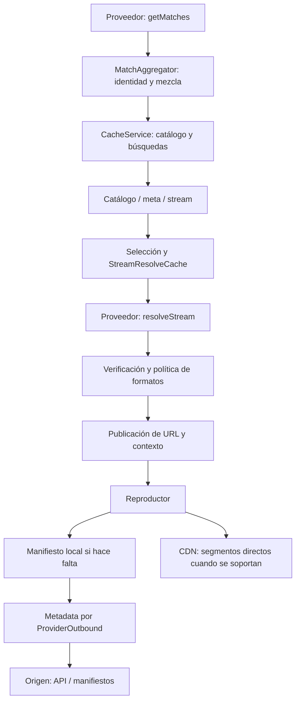

# Guía para añadir y mantener proveedores

[English version](PROVIDER_GUIDE.en.md) · [Plantilla de PR y encargo para una IA](PROVIDER_PR_TEMPLATE.md)

Esta guía explica cómo elegir una implementación, conectarla al addon, demostrar
que funciona y mantenerla cuando cambia el proveedor. Las reglas de contribución
que propone no sustituyen la configuración real de GitHub ni garantizan que un
servicio externo permanezca disponible. Toda afirmación debe corresponder al
commit, entorno, formato y reproductor que se probaron.

## Índice

1. [Versión y requisitos](#1-versión-y-requisitos)
2. [Elegir la implementación](#2-elegir-la-implementación)
3. [Flujo y responsables de las solicitudes](#3-flujo-y-responsables-de-las-solicitudes)
4. [Contrato de entidades](#4-contrato-de-entidades)
5. [Archivos y puntos de integración](#5-archivos-y-puntos-de-integración)
6. [Peticiones y guard de destinos](#6-peticiones-y-guard-de-destinos)
7. [APIs, HTML y errores parciales](#7-apis-html-y-errores-parciales)
8. [Fechas e identidad](#8-fechas-e-identidad)
9. [HLS: master, variantes y recursos](#9-hls-master-variantes-y-recursos)
10. [Headers y compatibilidad con reproductores](#10-headers-y-compatibilidad-con-reproductores)
11. [Tokens, rutas firmadas y egress](#11-tokens-rutas-firmadas-y-egress)
12. [Caché, concurrencia y prewarm](#12-caché-concurrencia-y-prewarm)
13. [Salud y diagnóstico](#13-salud-y-diagnóstico)
14. [Formatos soportados y coste de vídeo](#14-formatos-soportados-y-coste-de-vídeo)
15. [YAML y generador](#15-yaml-y-generador)
16. [Build y extractores](#16-build-y-extractores)
17. [Pruebas y comandos](#17-pruebas-y-comandos)
18. [Validación aislada y evidencia](#18-validación-aislada-y-evidencia)
19. [Merge, VPS y configuración](#19-merge-vps-y-configuración)
20. [Diagnóstico por síntomas](#20-diagnóstico-por-síntomas)
21. [Lecciones y revisión final](#21-lecciones-y-revisión-final)
22. [Referencias del código](#22-referencias-del-código)

## 1. Versión y requisitos

**Referencia de esta edición: 4 de noviembre de 2026.** Separar dos perfiles:

| Perfil | Qué representa |
| --- | --- |
| Base documental | `stable` en `92589e4c0bef327d7cc483c3fbe2d40908ba8e17` |
| Integración guardada | #59 `6ada76562e104598db601c478dabf88437e0556b` y #61 `0c559a6bb5037eb1a02b0919dd399ea328126694`; #61 incluye ese #59 |

Al preparar esta guía, ambos PR seguían abiertos y aún no estaban fusionados.
`ProviderOutbound`, las correcciones de identidad/recuperación y los runners
citados pertenecen al perfil integrado: **no existen todos en aquella base
`stable`**. Los ejemplos de transporte y pruebas siguientes requieren ese perfil.
Antes de implementarlos, integrar la dependencia o declarar el nuevo PR dependiente;
no sustituir módulos ausentes por peticiones sin guard.

Al empezar, registrar base, dependencias y candidato exactos. Antes de publicar o
resolver un conflicto, volver a comprobarlos. Los SHA anteriores identifican esta
edición; no son nombres permanentes para futuras versiones.

```sh
git status --short
git rev-parse HEAD HEAD^{tree}
git log -1 --format='%H %P'
```

Estos comandos solo inspeccionan el checkout. Un nombre de rama, una carpeta
sin `.git` o un hash de build por sí solos no prueban el origen del código.

Vocabulario usado en la guía:

| Término | Significado aquí |
| --- | --- |
| Metadata / media | Catálogos y manifiestos / bytes de audio o vídeo; tienen costes y pruebas diferentes |
| Mint | Solicitar al origen una credencial o URL de reproducción mediante su mecanismo admitido |
| Egress | Salida de red efectiva: ruta directa o proxy, IP y perfil que afectan la petición |
| Pin | Identidad/certificado esperado del resolver, cargado por el worker |
| Preflight | Verificación previa a publicar el stream; no demuestra playback en el dispositivo |
| Single-flight | Compartir una operación en curso por clave en lugar de duplicarla para cada petición |
| Claim / revisión | Propiedad temporal del trabajo / versión de una publicación de caché |

## 2. Elegir la implementación

Primero documentar qué entrega el origen y qué deberá hacer el servidor.

| El proveedor entrega… | Implementación adecuada | Prueba que la distingue |
| --- | --- | --- |
| JSON con eventos y HLS directo | Clase de proveedor, parser por fila y resolución separada | Evento válido/malformado/válido; salida real hasta publicación |
| HTML con páginas puente o iframes | Extractor acotado por formato/host | Links relativos respecto de la URL final de cada página |
| HTML simple que solo abre un reproductor web | YAML, si sus límites son aceptables | `externalUrl` correcto; no presentarlo como media directa |
| Master HLS y varias pistas | Resolver más reescritura común HLS | Vídeo, audio, I-frame, hijos sin extensión y redirects |
| URL firmada que caduca | Resolución/mint oficial al necesitarla; caché acorde | Antes/después de expiración y recuperación acotada |
| Token ligado a IP o perfil TLS | Mint y manifiesto con egress/perfil coherentes | Misma configuración efectiva; playback real desde el dispositivo |
| Canales 24/7 | Identidad de canal, número, país y marca `networks` según contrato | Canal 1 distinto del 2; canal distinto de partido programado |
| Replays/VOD | Identidad y fecha de grabación; registro como replay | Dos encuentros de los mismos equipos y juegos distintos no se fusionan |
| Solo una página web alternativa | `externalUrl` con etiqueta honesta y política de reintento | La alternativa no cuenta como reproducción directa aprobada |
| DASH/ClearKey o contenido no soportado | Filtrar conforme a la política vigente | No aparece entre los streams ofrecidos |
| Segmentos PNG, HTML de aviso o bytes desconocidos | Clasificar con evidencia; excluir lo no soportado | Muestra acotada y/o player real, sin deducir formato de la extensión |

Una misma fuente puede necesitar varias filas. Un nuevo endpoint de streaming
solo se justifica si las rutas y servicios existentes no resuelven su contrato.
Documentar esa diferencia antes de añadir código compartido o nuevos transportes.

## 3. Flujo y responsables de las solicitudes



El diagrama describe el diseño de metadata con segmentos directos. No certifica
que cada ruta heredada lo cumpla ni autoriza un nuevo relay de vídeo.

Para cada proveedor completar una tabla como esta antes de programar:

| Solicitud | Quién la hace | URL/base y headers | Egress | Límite y resultado esperado |
| --- | --- | --- | --- | --- |
| Catálogo | Servidor | API de eventos, `Accept` apropiado | Política aprobada | JSON completo; vacío distinto de error |
| Canales/mint | Servidor | API oficial; credenciales privadas si existen | El que exija el token | Respuesta acotada; sin logs privados |
| Master/hijo | Servidor o player, explícitamente | URL final y contexto de esa etapa | Coherente con el mint | HLS válido, no truncado ni aviso |
| Segmento/key/map | Normalmente player | URI y contexto de ese recurso | Red del dispositivo | Bytes compatibles y acceso real |
| Alternativa web | Navegador/dispositivo | Página externa etiquetada | Red del dispositivo | Apertura web; no PASS de media nativa |

No transferir al cliente una credencial privada del servidor para completar una
fila. Si no se puede satisfacer el contrato sin hacerlo, declarar la limitación.

## 4. Contrato de entidades

Una clase dedicada normalmente extiende `src/providers/BaseProvider.js`:

```js
class ExampleProvider extends BaseProvider {
  constructor(opts = {}) {
    super(opts); // BaseProvider destructura el objeto de opciones.
    this.name = 'Example';
    this.sourceName = 'example';
  }
  isEnabled() { return process.env.EXAMPLE_ENABLED === 'true'; }
  // getMatches() -> Promise<MatchEntity[]>
  // resolveStream(sourceId, matchCategory, matchTitle, src) -> Promise<StreamEntity[]>
}
```

Es un esquema, no un proveedor completo. La clase base no registra el toggle,
no implementa el parser y no conecta el dispatcher automáticamente.

| Dato | Contrato y cuidado |
| --- | --- |
| `MatchEntity.id` | Identidad canónica estable; prefijo de proveedor cuando corresponda. No usar posición en el feed, URL firmada, token o `Date.now()` como identidad |
| `aliasIds` | Compatibilidad de IDs conocidos; una colisión ambigua no elige la primera ficha |
| `title`, `category` | Título validado y categoría canónica; conservar país, edad, género, reservas y sesión |
| `date` / `timestamp` | Fecha real normalizada; el constructor produce una cadena epoch en milisegundos. `timestamp` tiene prioridad si se suministra |
| `status` | Mapear estados conocidos; por ejemplo `live`, `upcoming`/`pre`, `finished`/`ended`, `postponed`, `cancelled`. No inventar disponibilidad |
| `sources` | Array de alternativas con `source`, `id` y contexto necesario para resolver la misma fuente después |
| `isReplay`, `isChannel` | Ayudan a clasificar; por sí solos no actualizan todos los registros del addon |
| `StreamEntity.url` | Media o ruta de manifiesto soportada; no una página HTML disfrazada |
| `StreamEntity.externalUrl` | Alternativa web explícita; no prueba compatibilidad con el reproductor nativo |
| `_source`, `sourceName` | Identificadores coherentes con selección, dispatcher, etiquetas y salud |
| `behaviorHints` | Contexto del reproductor sujeto a verificación/publicación; no equivale a evidencia de playback |

Categorías reconocidas por el helper actual: `football`, `cricket`, `basketball`,
`motorsport`, `hockey`, `baseball`, `mma`, `golf`, `tennis`, `rugby`,
`american_football`, `darts`, `college`, `networks`, `other`. Revisar el mapeo
concreto: etiquetas como AFL pueden ser ambiguas entre deportes. No crear un ID
de categoría que ningún catálogo consulte.

Ejemplo de mapeo de una fila **ya validada** de una API ficticia:

```js
new MatchEntity({
  id: `example_${row.id}`,
  title: row.title,
  category: this.normalizeCategory(row.sport),
  date: String(kickoffMs),
  sources: [{ source: 'example', id: String(row.id) }]
});
```

Los constructores de entidades no sustituyen la validación de esquema, calendario
o identidad. `StreamEntity` conserva campos concretos; comprobar que un campo
nuevo sobrevive al constructor, a la caché y a la publicación.

## 5. Archivos y puntos de integración

| Lugar | Qué revisar/cambiar cuando aplique |
| --- | --- |
| `src/providers/ExampleProvider.js` | Descubrimiento y resolución separados; toggle y validación |
| `src/container.js` | Import y registro Awilix; nombre de registro consistente |
| `src/services/MatchAggregator.js` | Inyección en constructor y `this.providers`; exclusión real cuando está apagado |
| `src/streams.js` | `dispatchToProvider`, listas live/replay y `KNOWN_FALLBACKS`, prioridad y etiquetas |
| `src/catalog.js` | `REPLAY_SOURCES` para nuevos replays; verificar clasificación en todos los catálogos |
| `src/services/StreamResolveCache.js` | Política de TTL y contexto si la actual no cubre la nueva fuente |
| `public/configure.html` | Checkboxes estáticos `liveSourcesGrid` / `replaySourcesGrid`; configuración antigua y nueva |
| `.env.example` | Nombres de variables, defaults y ejemplo sin credenciales reales |
| `src/index.js` | Mount si hay ruta nueva; orden respecto al proxy resolver; `STREAM_PREFIXES` y regex de URLs absolutas |
| `src/services/HlsRewriteService.js` | Reutilizar el contrato común; probar a los demás proveedores si se modifica |
| `scripts/copy-guarded-worker-deps.js` | Helpers requeridos por extractores o procesos copiados fuera del bundle |
| `tests/` y runners offline | Fixtures de parser, integración y límites; selección consciente de suites |
| Documentación | Formatos soportados, limitaciones, variables, pruebas y evidencia |

`/api/options` publica idiomas y filtros replay; no es un registro universal de
proveedores. No basta añadir un checkbox ni un import.

Probar selección por ausencia de configuración, inclusión explícita, exclusión y
`none`, además de los formatos de configuración heredados. En la implementación
auditada, la cadena literal `sources=all` no funciona como wildcard; no asumirlo.
YAML tiene una excepción heredada de selección incluso con listas `none`: no
presentarla como aislamiento completo sin corregirla y probarla.

El toggle debe cubrir catálogo, despacho directo y rutas públicas nuevas. Una
ruta montada incondicionalmente puede seguir haciendo peticiones aunque el
proveedor no aparezca en el catálogo. Con el proveedor apagado, comprobar cero
I/O y una respuesta controlada en todos los accesos aplicables.

## 6. Peticiones y guard de destinos

En el perfil integrado, toda nueva petición de metadata debe entrar por
`src/services/ProviderOutbound.js`. Una validación de URL y el guard de conexión
cumplen funciones distintas: hacen falta ambas cuando el contrato las exige.

```js
const outbound = require('../services/ProviderOutbound'); // desde providers/

async function fetchCompleteJson(url, signal) {
  const response = await outbound.safeFetch(url, {
    headers: { Accept: 'application/json' },
    signal,
    timeoutMs: 8000,
    maxBodyBytes: 256 * 1024,
    attempts: 1,
    diagnosticOwner: 'catalog'
  });
  if (!response || !response.ok) {
    const error = new Error('Provider catalog unavailable');
    error.code = 'ERR_EXAMPLE_CATALOG_HTTP';
    error.upstreamStatus = response?.status;
    throw error;
  }
  if (response.bodyTruncated) {
    throw Object.assign(new Error('Provider metadata exceeds limit'), {
      code: 'ERR_EXAMPLE_METADATA_LIMIT'
    });
  }
  return response.json(); // Después, validar el esquema específico.
}
```

Los 8s/256KiB son elecciones de este ejemplo; medir cada API. El perfil compartido
auditado usa por defecto 15s/1MiB, admite 1–3 intentos, un presupuesto total de
hasta 30s y hasta 8MiB de cuerpo bufferizado. No usar esos máximos como objetivos
para cada solicitud ni multiplicar reintentos de varias capas sin presupuesto.

- `safeFetch`: `ok`, `status`, `headers`, `url`, `bodyTruncated` y métodos de cuerpo.
- `request`: `statusCode`, headers simples y métodos en `body`; no confundirlo con `Response`.
- `fetch`/`fetchUndici`: `Response` bufferizada con URL final y truncación.
- `streamingFetch`: otro contrato; no es un sustituto general para metadata acotada.

`BaseProvider.proxyFetch()` entra en el adaptador integrado, pero solo reenvía
algunas opciones. Actualmente no pasa `proxyUrl`, `profile` ni `redirect` y puede
usar un proxy CF configurado. Si se necesita control de egress, usar el adaptador
directamente. Un wrapper remoto introduce su propia frontera de confianza: que
el guard valide la URL del proxy no demuestra que ese servicio valide su destino.

Evitar nuevas peticiones mediante `../impitClient`, `undici`, `fetch` global,
clientes nativos o curl creados dentro del proveedor. Las excepciones de transporte
requieren integrar la protección común, cancelación, límites y pruebas; el curl
guardado de DamiTV no es permiso para lanzar curl con URLs arbitrarias.

No resolver incompatibilidades desactivando TLS, permitiendo loopback/redes
privadas, siguiendo redirects fuera del guard o añadiendo fallback directo cuando
se exige proxy. La comprobación abarca DNS y cada salto en el punto de conexión;
comprobar solo `http(s)` o el mismo origen no lo sustituye.

Al elegir hosts, parsear `URL.hostname` y comparar host exacto o subdominio con
frontera de punto. `url.includes('proveedor.com')` acepta el texto en un path,
query o dominio impostor. Rechazar credenciales embebidas y validar protocolos y
puertos según la política. Un link entregado al player no es una petición hecha
por el servidor: documentar qué se valida en cada frontera.

## 7. APIs, HTML y errores parciales

**API/feed:** validar la raíz, arrays, filas y tipos antes de iterar. Procesar
cada unidad independientemente: válido → `null`/malformado → válido debe conservar
ambas entradas válidas. Ante varios deportes/endpoints, conservar los éxitos y
registrar la degradación. Si todos fallaron, informar fallo total en lugar de
aparentar un catálogo vacío sano.

**HTML/iframe:** resolver referencias respecto de la URL efectiva de la página
que las contiene, después del redirect. Aplicar esa regla en cada página puente.
Acotar profundidad, número de candidatos y solicitudes. Una opción fallida no
debe borrar otras opciones independientes. No ejecutar código arbitrario del HTML.

**M3U/texto:** probar LF/CRLF, encabezados en otro orden, campos ausentes y valores
que contienen `=`. Separar por el primer delimitador cuando el valor puede
contenerlo. Limpiar el contexto de headers entre entradas para evitar que el
stream siguiente herede credenciales o UA del anterior.

Rechazar metadata truncada antes de parsear, reescribir o cachear éxito, incluso
si su prefijo parece JSON/HLS válido. Si una operación solo pretende muestrear un
prefijo, nombrarla como sondeo y no reutilizar ese resultado como catálogo completo.

## 8. Fechas e identidad

Identificar unidades de timestamp, zona horaria y si el dato significa kickoff,
día de replay, estado LIVE o publicación de una noticia. Validar rangos y hacer
round-trip de componentes: `Date.UTC` normaliza, por ejemplo, un mes 13 a otro año;
que produzca un número no hace válido el calendario original. Probar cambio de
día UTC, horario de verano y meses/días inválidos con reloj controlado.

No sustituir fechas desconocidas por la hora actual para mejorar el orden. El
caso Leaf LIVE sin hora es una decisión específica existente, no una receta para
todos los feeds. Un 24/7 puede carecer de kickoff; un partido sin fecha no se
convierte por eso en canal. Un replay con día local no tiene automáticamente una
hora UTC precisa.

La identidad debe preservar:

- Partido: participantes, categoría, fecha y calificadores de cada participante.
- Equipos: género, edad, reservas y orden invertido sin cruzar las etiquetas.
- Motorsport: serie y sesión; clasificación y carrera no son el mismo evento.
- Replay: día/horario, número de juego y restricciones de los eventos originales.
- Canal: país, número y señal; un canal genérico no acredita derechos sobre un partido.

Usar los servicios comunes (`EventSquadIdentity`, `ChannelIdentityService`,
`BroadcasterMatchService` y la lógica del agregador cuando estén presentes).
No añadir fuzzy matching paralelo para saltarse sus restricciones. Probar
acentos/Unicode, alias legítimos y dos encuentros cercanos de los mismos equipos.

Para recuperación y caché, usar `StreamResolveCache.resolveKey(src, match.id)`
con el ID canónico encontrado, no el alias que llegó en la petición. Un alias
ambiguo debe producir ausencia/ambigüedad explícita, no el primer resultado.
En carry-forward, exigir vigencia y compatibilidad semántica aun si coincide
un ID antiguo. No añadir al nuevo proveedor a una lista de rescate sin definir
retención, identidad, límite y efecto en la salud.

## 9. HLS: master, variantes y recursos

Reutilizar `HlsRewriteService` y mantener el significado de cada URI. La extensión
no siempre revela si el recurso es una playlist, key, mapa o segmento.

| Referencia | Tratamiento que hay que comprobar |
| --- | --- |
| Línea tras `EXT-X-STREAM-INF` | Variante de vídeo, incluso si no termina en `.m3u8` |
| `EXT-X-MEDIA:URI` | Playlist de audio/subtítulos según el formato; no confundir con vídeo |
| `EXT-X-I-FRAME-STREAM-INF`, `EXT-X-IMAGE-STREAM-INF` | Playlists auxiliares con identidad propia |
| `EXT-X-RENDITION-REPORT` | Referencia a otra playlist; soportarla o declarar el límite |
| `EXT-X-KEY`, `EXT-X-SESSION-KEY` | Recurso de clave: conservar semántica y autenticación; no convertirlo en variante por su sufijo |
| `EXT-X-MAP` | Init segment; conservar parámetros/rangos |
| `EXT-X-PART`, `EXT-X-PRELOAD-HINT` | Recursos de LL-HLS; probar expresamente si se anuncian compatibles |
| Segmentos de media | URLs directas y contexto que el player pueda usar, según la política soportada |

Un callback como `toPlaylistUrl` debe compartir el mismo mapa de URIs con la
ruta que resuelve índices. No usar un contador sobre un conjunto de tags y
resolverlo sobre otro. Probar audio antes del vídeo, I-frame antes de la primera
variante, URIs repetidas, índices inexistentes y cambios del master al refrescar.
Si las variantes se reordenan, un índice antiguo no debe resolver otro contenido
silenciosamente: usar un snapshot/identidad coherente o fallar de forma controlada.

Resolver hijos respecto de la URL final del manifiesto, no de la URL anterior al
redirect. Conservar los query firmados sin doble decode/encode. La herencia de
parámetros en referencias relativas debe seguir el contrato; nunca copiar un
token a otro origen por conveniencia. Probar URLs con `%2B`, `%2F`, `%3D` y `=`.

La presencia de `#EXTM3U`, un HTTP 200 o una lista de segmentos no demuestra que
sean media útil. Detectar avisos conocidos, HTML, error JSON y truncación antes
de cachear. El helper existente no garantiza automáticamente todos los casos de
esta tabla: añadir la cobertura que falte antes de anunciar soporte.

## 10. Headers y compatibilidad con reproductores

Especificar qué headers necesita cada fila de la tabla de solicitudes. Un
`Referer` puede tener path; `Origin` debe ser un origen válido, sin ese path.
Normalizar casing de nombres sin cambiar valores y acotar longitud/caracteres.

En redirects entre orígenes, la política integrada conserva solo `Accept`,
`Accept-Language`, `Accept-Encoding`, `User-Agent`, `Range`, `Content-Type` y
`Content-Encoding`. Descarta `Referer`, `Origin`, `Cookie`, `Authorization` y
headers personalizados. No reintroducirlos automáticamente en el siguiente salto.
Un valor permitido también puede contener un secreto; la lista no lo sanea.

`behaviorHints.proxyHeaders` no garantiza que todos los dispositivos envíen esos
headers en master, hijo, segmentos y keys. Probar los players declarados, incluidos
MPV y Stremio/Exo/Nuvio cuando formen parte del objetivo. Si un navegador no puede
satisfacer el contrato, declarar el límite en lugar de activar un relay silencioso.

**Atención a la verificación del propio addon:** actualmente `notWebReady:false`
puede omitir el preflight. Cambiarlo a `true` puede provocar una petición a una
ruta local personalizada, que el guard rechaza si el addon usa LAN/loopback.
La publicación también modifica estos hints y los headers. Probar siempre la
salida real de `resolveStream()` a través de verificación y publicación, con
URL pública y privada del addon. No modificar el fixture a mano para saltar la
rama problemática ni permitir localhost en el guard para resolverla.

Un UA particular puede cambiar la respuesta: separar la caché por contexto
normalizado cuando sea necesario y propagar únicamente el contexto autorizado a
los hijos. No propagar cookies/Authorization del origen a la URL pública del addon.

## 11. Tokens, rutas firmadas y egress

Para tokens cortos o ligados a IP, preferir un identificador local opaco y el
mint oficial al solicitar el manifiesto. Definir exactamente qué se firma y qué
contexto determina el contenido; no inventar credenciales upstream ni saltar un
aviso de autorización con otra identidad.

Una ruta firmada nueva debe:

1. Usar una clave privada configurada y compartida entre workers; sin clave, fallar cerrado. No incluir una constante pública de desarrollo como fallback.
2. Acotar longitud y tipos de token, IDs, query y payload antes de trabajo costoso; considerar arrays/objetos que pueda producir Express.
3. Validar encoding y longitud **en bytes** antes de `timingSafeEqual`; entradas Unicode no deben lanzar `RangeError`.
4. Comprobar esquema, versión si se usa, timestamp de emisión y vida máxima; rechazar futuro, expirado o campos ausentes.
5. Vincular los selectores que autorizan contenido, o validarlos contra el conjunto autorizado; no permitir destinos arbitrarios mediante query.
6. Capturar errores desde el comienzo del handler y devolver un 4xx/5xx fijo sin URL/token/error privado.
7. Aplicar límites de solicitudes y estado aun a firmas válidas; definir identidad de cliente mediante proxies confiables, no confiar ciegamente en `X-Forwarded-For`.

Elegir egress una vez y conservarlo durante la operación. Para los hosts que
`GuardedEgressPolicy` clasifica como Leaf, la prioridad auditada es
`LEAF_PROXY_URL → WARP_PROXY_URL → DAMITV_PROXY_URL`; Dami usa WARP→DAMITV.
El clasificador Leaf excluye `w1.papacito.cfd` y sus subdominios: no asumir que
todo host con marca Leaf recibe automáticamente ese proxy. Verificar el egress
efectivo de cada etapa y cualquier excepción contra el contrato del token.
`proxyUrl:null` es una elección explícita de ruta directa, no una variable ausente.
No copiar estas prioridades a otro proveedor sin justificarlo. Un proxy requerido
no permite fallback directo si falla.

Separar recuperación de expiración de errores locales:

| Señal | Respuesta apropiada |
| --- | --- |
| Expiración upstream confirmada por su contrato | Invalidación condicional y como máximo el reintento/mint definido dentro del presupuesto |
| `ERR_OUTBOUND_BLOCKED`, capacidad o fallo nativo local | Error local; no remint, bypass ni nueva identidad |
| 429 | Backoff/cooldown acotado; no tormenta de cache-busters |
| Aviso de autorización, instalación o media no soportada | Rechazar y explicar la limitación; no fingir éxito |
| Timeout/5xx | Política transitoria documentada; stale solo si sigue siendo válido y no oculta una denegación |

Un 403 no demuestra por sí solo expiración. La URL del master puede seguir
vigente mientras falla un segmento firmado: comprobar también esa etapa.

Mint y manifiesto con la misma salida no garantizan segmentos directos válidos.
Si la autorización del segmento también está ligada a la IP del servidor, un
player con otra IP puede fallar aunque el master funcione. Verificar ese contrato;
si el origen no ofrece un mecanismo compatible con la entrega directa, declarar
el caso no soportado en lugar de introducir un relay de vídeo automáticamente.

## 12. Caché, concurrencia y prewarm

| Estado | Qué debe definir |
| --- | --- |
| Catálogo | Vigencia, cambio de fecha, resultados parciales y ruta de almacenamiento |
| Resolución positiva | Clave canónica, contexto y expiración real; clonar antes de personalizar |
| Resultado negativo/web fallback | TTL corto justificado y oportunidad de volver a intentar media directa |
| Mint/playback | Límite por credencial y egress, single-flight y cooldown |
| Manifiesto | TTL por live edge, snapshot de variantes y cuerpo completo |
| In-flight | Limpieza en éxito/error/cancelación; no retener promesas rechazadas |
| IP/rate limits | Tamaño máximo, ventana y eliminación; fuente confiable de identidad |

Poner TTL no elimina automáticamente claves viejas de un `Map`. Acotar entradas,
retirar expiradas y probar crecimiento, errores y abortos. No cachear un resultado
personalizado para otro usuario o UA. Una ruta local opaca no permite al cache
inferir automáticamente cuándo vencerá la credencial escondida.

Valores actuales de resolución: base de 60s para positivos, 30s para negativos,
máximo de 200 entradas y adaptación hasta 10min; Daddy tiene un límite de 150s y
Leaf una excepción de 4h. Son detalles
del perfil y configuración actual, **no defaults universales para proveedores
nuevos**. Probar cualquier cambio en `StreamResolveCache`, no copiar una excepción.

La caché compartida usa revisiones e invalidación condicional. No reemplazarlo
por borrado incondicional que pueda eliminar una publicación más nueva. No
mutar snapshots prestados ni liberar un claim que pertenece a otra operación.

Limitar fan-out y presupuesto total, incluyendo DNS, cola, redirects, reintentos
y lectura. El supervisor nativo aislado usa 4 slots por defecto por pool y admite
`GUARDED_NATIVE_MAX_SLOTS` entre 1 y 8; el backend `NativeGuardedFetch` tiene su propio
máximo de 4 por pool/contexto. No existe por ello un límite único de 4 para todo el VPS:
varios workers/pools multiplican los recursos. Comprobar backend, procesos y límite
total del despliegue; subir los caps para encajar un proveedor no es un arreglo
de integración. Un timeout exterior de sync no cancela por sí solo trabajo interno:
pasar señales donde el contrato lo permita.

El prewarm es opcional y separado de la resolución interactiva. Evaluar coste,
vida de tokens y bloqueos antes de activarlo. Revisar `DEFAULT_PREWARM_SKIP_PROVIDERS`
y que un `PREWARM_SKIP_PROVIDERS` explícito reemplaza el default, no lo amplía.
Si se excluye de prewarm, debe seguir resolviendo al hacer clic cuando esté habilitado.

## 13. Salud y diagnóstico

| Estado actual | Significado que debe conservar |
| --- | --- |
| `healthy` | Obtención correcta con fixtures |
| `empty` | Respuesta válida sin fixtures; distinto de fallo de transporte |
| `degraded` | Resultado parcial o schedule fallido expuesto por el contrato |
| `error` | Fallo total o excepción reportada |
| `cached` | Reutilización identificada de datos anteriores |

`lastScheduleOk === false` comunica degradación a `ProviderHealthService` en la
implementación actual. No esconder todos los errores detrás de `return []` ni
sobrescribir un intento nuevo con el resultado tardío de uno agotado.

Registrar clase de error, estado HTTP, fase, duración y correlación segura. No
registrar secretos, install blobs, cookies, Authorization, URLs firmadas, claims
JWT de identidad, credenciales de proxy o el catálogo privado. Los errores de
librerías pueden incluirlos en `message`. La redacción actual de salud no elimina
todos los paths o userinfo: no tratarla como sanitizador universal.

Si hace falta identificar una URL, guardar host permitido y clasificación o una
huella no reversible apropiada al caso; no compartir su query/path privado.
Una huella tampoco prueba que el contenido se reprodujo.

## 14. Formatos soportados y coste de vídeo

Distinguir metadata de media. Reescribir un manifiesto pequeño y devolver URLs
CDN permite que el player descargue segmentos; decodificar o retransmitirlos en
el VPS cambia coste, rendimiento y contrato operativo.

La política actual de `stable925` deja de **ofrecer** DASH/ClearKey retransmitido.
No añadir productores que lo vuelvan a publicar ni anunciarlo como requisito de
aceptación. Que persistan rutas heredadas no significa soporte ofrecido o guard
completo de todas las rutas de vídeo.

**Política acordada con Raj para DaddyLive:** soportar la ruta `/player` cuando
entregue segmentos MPEG-TS reales. Excluir las alternativas dembed/premium que
requieran decodificar PNG en el servidor; evitar que reaparezcan mediante otro
fallback. Es una decisión de soporte, no una demostración de que todas las URLs
con esos nombres tienen el mismo formato o de la causa de cada404 histórico.

`.ts`, `.png`, `Content-Type` y HTTP 200 por separado no prueban el formato.
Distinguir TS real, TS con prefijo, PNG real/comprimido y aviso/HTML mediante
una muestra acotada autorizada y playback. Si no se sabe, marcarlo desconocido.
No aplicar un offset de 42 bytes, BYTERANGE o decoder a todos los segmentos por similitud
con otro proveedor. Conservar un control funcional de la ruta soportada y
registrar las exclusiones, en lugar de prometer que todos los enlaces funcionan.

## 15. YAML y generador

```sh
npm run generate:provider -- Example
```

Ese comando crea **solo** `src/providers/yaml/example.yml`. No genera una clase
JS completa, dispatcher, ruta, tests ni integración del reproductor. Revisar el
archivo antes de ejecutarlo y no sobrescribir uno existente.

`GenericYamlProvider` vive en `src/services/YamlProviderBuilder.js`. El código
auditado usa IDs por índice, `Date.now()` como fecha y `externalUrl`; lee el texto
de `selectors.time` sin convertirlo en kickoff y resuelve respecto de `baseUrl`,
no necesariamente la URL efectiva tras redirects. Sus límites requieren mejoras
o una clase dedicada para fixtures con identidad, horarios, mint o HLS directo.

Usar YAML solo cuando un web handoff simple sea el resultado deseado y esos
contratos se hayan revisado. No llamar al scaffold una integración terminada ni
apagar validaciones para encajar un proveedor complejo dentro de YAML.

## 16. Build y extractores

`npm run build` usa ncc y copia extractores JS/WASM y assets a `dist.next`.
Algunos scripts de proveedor quedan en una distribución plana diferente de
`src/providers/`. Un `require('../services/...')` que funciona en source puede
fallar allí. Probar resolución de imports en ambos layouts sin iniciar WASM.

Cuando un helper sea necesario fuera del bundle, añadirlo al manifiesto de
copia correspondiente. Comprobar archivos copiados, imports relativos y assets
del build real. Un build que empaqueta un binario no prueba que ese binario
funcione en otra arquitectura, libc, Node o dispositivo.

No introducir un nuevo navegador, worker, subprocess o transporte sin definir
propiedad, límites y cancelación. En un child, enviar SIGTERM no prueba que haya
salido: esperar cierre antes de reutilizar recursos y comprobar descendientes.

## 17. Pruebas y comandos

Las pruebas deben fijar comportamiento observable y fallar si se pierde la
protección. Separar fixtures sintéticas, capturas sanitizadas y casos reales.
No adaptar los fixtures para evitar la rama que falla ni declarar un HTTP 200
simulado como evidencia de un proveedor real.

| Nivel | Casos mínimos aplicables |
| --- | --- |
| Parser | Vacío válido; válido/malformado/válido; null y tipos incorrectos; LF/CRLF y delimitadores |
| Identidad/fechas | Reordenación del feed; IDs reutilizados; alias ambiguos; país/señal; edad/género/reservas; calendarios inválidos y UTC |
| Transporte | DNS privado y mixto; redirect a destino bloqueado; credenciales URL; timeout/capacidad; cuerpo truncado; proxy sin fallback directo |
| Headers/HLS | Casing/UA; secretos entre orígenes; master/audio/I-frame/hijo sin extensión; URL final y query firmado |
| Estado firmado | Clave ausente; firma inválida/Unicode; tamaños máximos; futuro/expirado; query como array; toggle apagado |
| Caché | Expiración positiva/negativa; single-flight; error/abort y reintento; revisión/invalidation race; crecimiento limitado |
| Integración | Proveedor real con I/O simulado → agregación/cache → catálogo/meta → dispatcher → verificación → publicación |
| Compatibilidad | Provider existente antes/después de modificar helper compartido; configuración antigua/nueva y runtime/build layouts |
| Runtime | Transporte y player reales únicamente en instancia aislada adecuada |

Probar una ruta local con `BASE_URL` público y privado. Comprobar los campos y
headers después de la publicación, no solo al salir del parser. Si se añade una
excepción al verifier, demostrar que solo cubre rutas propias previstas y no
habilita peticiones arbitrarias del servidor.

Con dependencias bloqueadas instaladas y **perfil integrado presente**:

```sh
# Ejemplo: crear primero esta suite; el nombre no corresponde a un test existente.
node --require ./tests/fixtures/pr59-offline-boundary.cjs \
  ./node_modules/jest/bin/jest.js --runInBand \
  --runTestsByPath tests/exampleProvider.test.js

# Selecciones heredadas cuando el cambio las afecta:
node scripts/test-pr59-offline.cjs
node scripts/test-pr61-offline.cjs

# Build en el entorno de desarrollo preparado; puede usar herramientas vía npx.
npm run build
```

Node22.23.2, Node24.19.0 y Jest29.7.0 son las versiones usadas en las revisiones
de referencia; respetar el contrato Node>=22 del proyecto y registrar las propias.
`npm ci --include=dev` instala el lock en un checkout de desarrollo cuando haga
falta; no sustituirlo por actualizar dependencias de producción para probar una fuente.
No interpretar el límite de red/worker del runner como un fallo del proveedor.

Las suites offline bloquean conexiones, listeners y workers reales. Mockear
Router/transportes antes de importar módulos que podrían arrancarlos. Separar
suites con servidores, binarios o WASM y ejecutarlas solo en el entorno apropiado.
Tras pasar lo pertinente, ampliar pruebas si el diff, un fallo o una duda concreta
lo justifica. Una selección verde no significa que todo el repositorio pasó.

## 18. Validación aislada y evidencia

Usar una instancia a la vez si hay presión de RAM. Mantener build, puertos,
socket, credenciales de prueba y `MATCHES_CACHE_PATH` separados de producción.
No leer/escribir su caché activa para afirmar aislamiento; una copia privada debe
identificarse como copia, con su hash y momento de activación.

Orden de verificación:

1. Congelar SHA/tree y origen del staging; capturar instalación/build y hashes propios.
2. Confirmar configuración requerida y salud del addon/resolver; registrar checks omitidos como `NOT RUN`.
3. Recorrer catálogo → meta → stream usando el catálogo realmente activo.
4. Probar master → hijo → segmento/key y headers necesarios; distinguir sondeo de reproducción.
5. Reproducir en los dispositivos declarados y registrar player, versión, duración y resultado real.
6. Probar expiración/recuperación o egress solo cuando aplique y esté configurado.
7. Detener procesos propios: PID, start ticks, identidades de descendientes antes de salir y listeners. Un survivor es fallo; `pgrep` por texto no acredita propiedad.

Una muestra de segmento es distinta de HEAD y de playback. Un master exitoso,
un web fallback o un aviso no convierten un fallo de media en PASS. No repetir
una matriz completa de TLS/cache/rotación si el cambio no la afecta; conservar
su evidencia acotada y añadir la prueba específica necesaria del nuevo candidato.

Ejemplo de **plantilla sin resultados capturados**:

```json
{
  "candidate_sha": null,
  "tree_sha": null,
  "source_provenance": null,
  "build": { "exit_code": null, "index_sha256": null },
  "active_catalog": { "sha256": null, "events": null, "activated_at": null },
  "case": "provider -> published stream -> player",
  "status": "NOT RUN",
  "player": null,
  "started_at": null,
  "duration_seconds": null,
  "observations": [],
  "owned_shutdown": { "status": "NOT RUN" }
}
```

Usar `PASS`, `FAIL` y `NOT RUN` con razón y alcance. Conservar stdout/stderr,
comandos y exit codes originales sanitizados. Si no se guardó una salida,
indicarlo; no reconstruirla como log original. El hash del build identifica bytes,
no prueba por sí solo que el staging provenga del commit declarado.

## 19. Merge, VPS y configuración

Un merge en GitHub no exige editar el VPS. Un despliegue sí necesita comprobar
las dependencias y el entorno. Separar aceptación de código, aceptación de runtime
y habilitación del proveedor. Una fuente nueva opt-in puede permanecer apagada
mientras se valida; sus rutas también deben respetar ese apagado.

**Migración compartida de #59/#61:** el destino acordado es resolver externo por
Unix/TLS con pin. Si el VPS conserva solo el transporte TCP anterior, el merge
no lo migra. Sin modo seleccionado, las APIs dependientes pueden responder HTTP 503;
una configuración TLS explícita inválida puede impedir el arranque.

```dotenv
# Plantilla: sustituir rutas, hostname y puerto por los de la instancia real.
RESOLVER_TRANSPORT=systemd-unix-tls
RESOLVER_SOCKET_PATH=/run/<instance>/resolver.sock
RESOLVER_CERT_DIR=/path/to/public-identity
RESOLVER_TLS_SERVERNAME=resolver.internal
RESOLVER_PORT=7003
RESOLVER_TRUST_LEGACY_TCP=false
```

El directorio debe contener `resolver.crt`, público y entregado por una vía
confiable; la clave privada pertenece al resolver. Preparar servicio/socket,
permisos e identidad vigente antes de iniciar el addon: `.env` por sí solo no los
crea. El puerto indicado restringe las URLs del adaptador de caché; no habilita
un fallback TCP. El certificado HTTPS del sitio es otra identidad distinta.
No reutilizar en producción una identidad de prueba de vida corta ni copiar
unidades aisladas sin adaptarlas al despliegue.

Si la configuración válida ya existe, verificarla, no cambiarla por rutina.
Los workers deben compartir el pin y la clave privada elegida para estado local
cuando esa función esté habilitada. Leaf acepta `LEAF_STATE_SECRET` o `APP_SECRET`;
`SESSION_SECRET` por sí solo no satisface su contrato. El merge no exige rotar
secretos existentes ni habilitar Leaf u otro proveedor no configurado. DamiTV
sigue encendido por defecto salvo `DAMITV_ENABLED=false`; no confundirlo con
proveedores nuevos opt-in. El DASH retransmitido ya no ofrecido no obliga a una
nueva prueba de playback ni a una clave adicional solo para ese caso retirado.

Antes del rollout, comprobar health con HTTP 200, pin/CA/hostname correctos, petición
controlada y reproducción en aislamiento. Desplegar resolver y workers compatibles;
la invalidación compartida no conserva todas sus garantías con versiones mezcladas.
Un cambio de identidad requiere reiniciar los workers que cargaron el pin anterior.
No activar legacy TCP como atajo para hacer verde la salud.

Registrar el build/configuración anterior y el procedimiento de reversión. Revertir
un merge no restaura por sí solo credenciales, catálogo o procesos del VPS.
Documentar esos efectos y el orden del rollback; no ejecutar cambios de producción
como parte de una prueba de proveedor.

## 20. Diagnóstico por síntomas

| Síntoma | Qué comprobar primero | Qué no demuestra por sí solo |
| --- | --- | --- |
| No aparecen eventos | Toggle, registro, selección, categoría, fecha y salud | Que la API esté caída |
| Hay ficha pero no streams | ID canónico/source, dispatcher, verifier y política de formato | Que el parser del catálogo esté mal |
| Funciona público, falla por LAN | Preflight a ruta propia y base de publicación | Que haya que permitir redes privadas en el guard |
| Health HTTP 503 | Selección/configuración del resolver y pin | Que el upstream del proveedor esté caído |
| Addon devuelve404 | Origen del404, ruta, recuperación e identidad del evento | Un404 upstream o un problema PNG específico |
| HTTP 200 pero player falla | Master/hijo, headers, contenido y expiración de segmentos | Playback exitoso |
| Vídeo sin audio o variante404 | Tags/índices de master y snapshot, base final | Error de codec necesariamente |
| Falla tras unos minutos | Token, segmentos ya vencidos, egress y caché | Que aumentar TTL arregle el problema |
| PNG/empty segment | Bytes reales, aviso, compresión o prefijo documentado | Que `.ts` sea TS o que un offset de 42 bytes sea válido |
| 429 o capacidad nativa | Fan-out, cola, cooldown y presupuesto | Autorización para más reintentos o bypass |
| Solo falla tras build | Imports de distribución plana, helpers y assets | Que source ejecutado pruebe el bundle |
| RAM alta tras parar | Identidad/start ticks/descendientes y listener propios | Una fuga demostrada por contar procesos ajenos |

## 21. Lecciones y revisión final

| Caso de referencia | Lección reutilizable |
| --- | --- |
| Alias/prewarm/recuperación | Compartir constructor de clave con ID canónico |
| Guard403 tratado como expiración | Clasificar origen del error antes de remint |
| Leaf con proxy específico | Auditar prioridad efectiva también en el adaptador guardado |
| Clave fallback y firmas Unicode | Fallar cerrado y validar encoding/bytes antes de comparar |
| Scorezone: I-frame antes de vídeo | Publicación y resolución deben compartir exactamente el mapa de variantes |
| Scorezone: hint cambiado, fixture antiguo | Testear la salida real de la clase hasta publicación |
| DaddyLive124/19 | Un error del addon no acredita su causa upstream; conservar control y alcance |
| DaddyLive `/player` | Definir formato soportado, verificar bytes/player y excluir rutas que necesitan decoder no aprobado |
| Generador YAML | Scaffold y web handoff no equivalen a proveedor completo |

Los casos de Scorezone corresponden a la revisión de `3109411`, con reproducciones
sintéticas acotadas; no son un informe de playback de producción. La guía convierte
esos casos en pruebas exigibles, no en una afirmación de que otra versión siga fallando.

Flujo recomendado de contribución:

1. Un PR dedicado por proveedor; declarar dependencias y formatos antes de implementar.
2. Fixtures de comportamiento, integración y límites; cambios compartidos con regresiones pertinentes.
3. Primera revisión independiente de transporte/estado/recursos y segunda de identidad/HLS/compatibilidad; cerrar hallazgos sobre el árbol final.
4. Registrar checks y pendientes reales; acordar merge y rollout por separado.
5. Comunicar nuevo SHA/tree tras cambios; no atribuir pruebas del anterior al nuevo sin delimitar qué se conserva.

Son reglas propuestas para esta guía, no una afirmación de que GitHub ya exija
dos aprobaciones o de que cada proveedor necesite todos los dispositivos del mundo.
Aplicar la matriz de casos pertinentes y justificar los no aplicables. La
[plantilla de PR](PROVIDER_PR_TEMPLATE.md) permite dejar ese alcance revisable.

## 22. Referencias del código

Estos enlaces fijan el perfil auditado; consultar también el código del candidato real:

- [BaseProvider y proxyFetch](https://github.com/rajhodedara/live-sport-plugin/blob/0c559a6bb5037eb1a02b0919dd399ea328126694/src/providers/BaseProvider.js)
- [ProviderOutbound](https://github.com/rajhodedara/live-sport-plugin/blob/0c559a6bb5037eb1a02b0919dd399ea328126694/src/services/ProviderOutbound.js)
- [Entidades Match](https://github.com/rajhodedara/live-sport-plugin/blob/0c559a6bb5037eb1a02b0919dd399ea328126694/src/domain/MatchEntity.js) y [Stream](https://github.com/rajhodedara/live-sport-plugin/blob/0c559a6bb5037eb1a02b0919dd399ea328126694/src/domain/StreamEntity.js)
- [Agregación e identidad](https://github.com/rajhodedara/live-sport-plugin/blob/0c559a6bb5037eb1a02b0919dd399ea328126694/src/services/MatchAggregator.js)
- [Selección, verificación y publicación](https://github.com/rajhodedara/live-sport-plugin/blob/0c559a6bb5037eb1a02b0919dd399ea328126694/src/streams.js)
- [HlsRewriteService](https://github.com/rajhodedara/live-sport-plugin/blob/0c559a6bb5037eb1a02b0919dd399ea328126694/src/services/HlsRewriteService.js)
- [Selección de egress](https://github.com/rajhodedara/live-sport-plugin/blob/0c559a6bb5037eb1a02b0919dd399ea328126694/src/services/GuardedEgressPolicy.js)
- [Caché de resolución](https://github.com/rajhodedara/live-sport-plugin/blob/0c559a6bb5037eb1a02b0919dd399ea328126694/src/services/StreamResolveCache.js)
- [YAML y sus límites](https://github.com/rajhodedara/live-sport-plugin/blob/0c559a6bb5037eb1a02b0919dd399ea328126694/src/services/YamlProviderBuilder.js)
- [Migración del resolver](https://github.com/rajhodedara/live-sport-plugin/blob/0c559a6bb5037eb1a02b0919dd399ea328126694/docs/PR59_TRANSPORT_MIGRATION.md)
- [Revisión de mapping](https://github.com/rajhodedara/live-sport-plugin/blob/0c559a6bb5037eb1a02b0919dd399ea328126694/docs/PR61_MAPPING_REVIEW.md)
